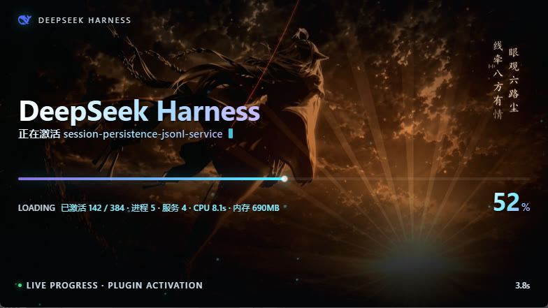

# dsh-startup-splash

给 [DeepSeek Harness](https://github.com/deepseek-ai) 加一块启动画面：启动的那十几秒显示**真实的插件激活进度**，窗口出现后自动关闭。

进度不是估的 —— 观察者插件订阅 Cordis 的 `internal/status` 事件，统计 384 个插件实例什么时候真正变成 `active`。



---

## 特点

- **真实进度**：不是假进度条，数字来自 Cordis 的 fiber 生命周期事件
- **不会提前说完成**：插件全加载完还有 6 秒在等 MCP，那段时间条和数字一起停，如实显示「正在等待服务就绪」
- **窗口出现才关闭**：不在 `dsh web:` 就收工，等主窗口真的可见
- **零残留**：Edge 缓存、临时文件全在 `runtime/`，可随时整个删掉
- **不影响启动速度**：观察者开销实测 **-0.16s**（噪声范围内）

---

## 快速开始

前提：**DSH 已完全退出**（托盘图标右键 → 退出）。

```powershell
# 1. 安装观察者到 profile
pwsh -NoProfile -File scripts\install.ps1

# 2. 以后用这个启动
双击 start-splash.cmd
```

卸载：

```powershell
pwsh -NoProfile -File scripts\uninstall.ps1
```

---

## 它显示什么

```
已激活 142 / 384 · 进程 5 · 服务 4 · CPU 8.1s · 内存 690MB      52%
```

| 段 | 进度 | 说明 |
|---|---|---|
| 启动引擎 | 0 → 37% | 进程树累计 CPU 驱动 |
| 加载插件 | 37 → 91% | `active / 预期总数`，数字不动条就停 |
| 呈现界面 | 91 → 100% | 就绪 → 窗口可见 |

实测四段耗时约 **6.7 / 3.1 / 6.0 / 1.7 秒**。

---

## 目录

```
start-splash.cmd   日常入口
splash.ps1         启动器
ui/                面板（HTML + 视频素材）
observer/          DSH 插件（只读观察者）
scripts/           install / uninstall / rollback / clean
tools/             诊断工具（不参与启动）
runtime/           运行期产物，可随时删
backup/            profile 备份
```

---

## 换画面

改 `ui/video.mp4` 一个文件即可。要求：**H.264 + yuv420p，1920×1080，10~20 秒**。

窗口按 16:9 设计（800×480），视频用 `object-fit: cover` 铺满，无黑边、无裁剪。

---

## 更多

实现细节、踩坑记录、诊断工具用法见 [docs/DESIGN.md](docs/DESIGN.md)。

---

## License

MIT
